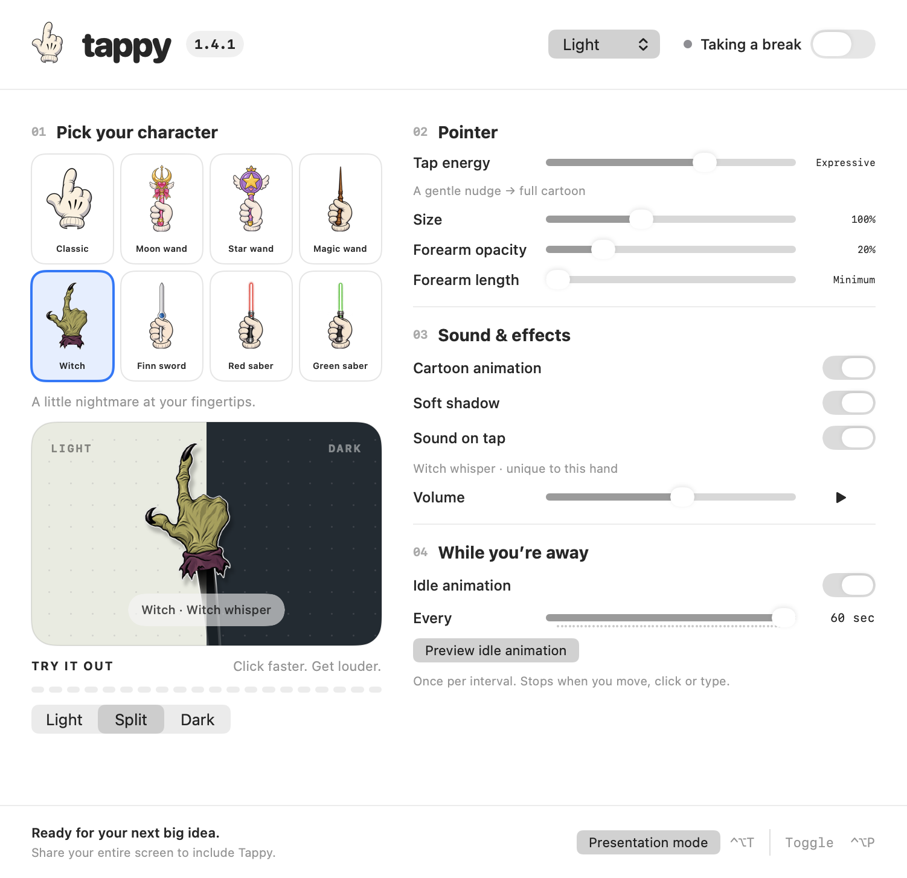
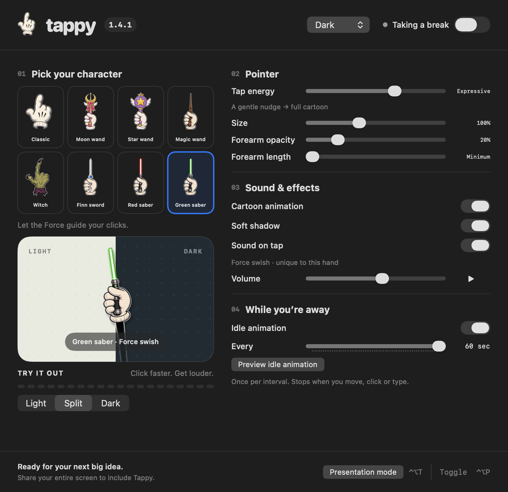
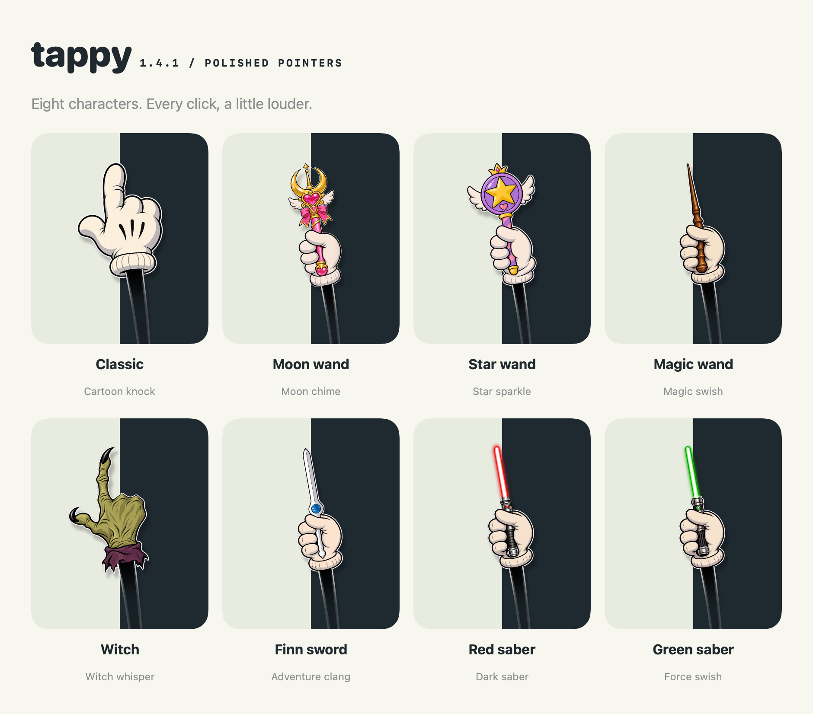
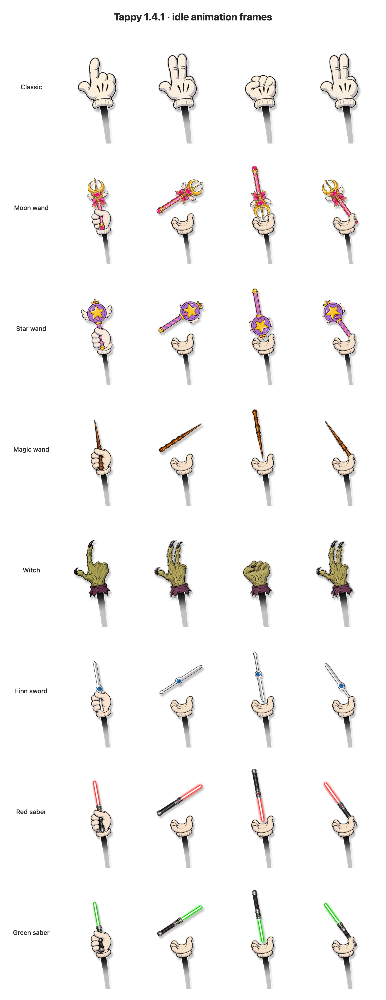
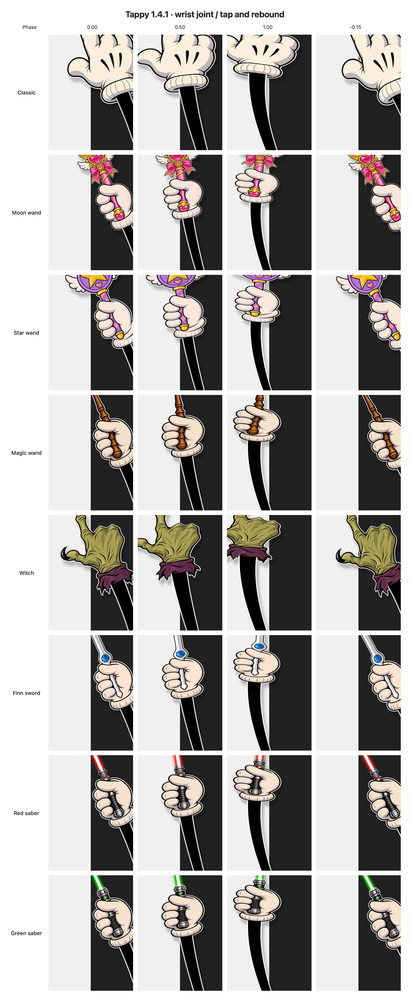

# Tappy 1.4.1

[Download Tappy 1.4.1 for macOS](https://github.com/Daniel-Poida/Tappy/releases/download/v1.4.1/Tappy-1.4.1.dmg) · [Release notes](https://github.com/Daniel-Poida/Tappy/releases/tag/v1.4.1)

A playful macOS pointer for presentations, demos and screen shares. Eight characters arranged in two rows, each with exactly four fingers and its own sound and a readable dark contour with a narrow white keyline.

| Character | Sound |
| --- | --- |
| Classic cartoon glove | Cartoon knock |
| Sailor Moon inspired wand | Moon chime |
| Princess Star inspired wand | Star sparkle |
| Wizard's magic wand | Magic swish |
| Horror witch hand | Witch whisper |
| Finn's silver sword with blue gem | Adventure clang |
| Red lightsaber | Dark saber |
| Green lightsaber | Force swish |

## Screenshots

| Light appearance | Dark appearance |
| --- | --- |
|  |  |



<details>
<summary>Idle animation frames: finger play and quick wand tosses</summary>





</details>

## What's new in 1.4.1

- Fixed the system arrow reappearing over Dock. While Tappy is enabled, its arrow image is transparent; the original image returns on disable and quit. An independent helper also restores it if Tappy exits unexpectedly. [Implementation and validation](docs/cursor-hiding.md).

## What's new in 1.4

- Retain balanced recovery after application, Space and display transitions. The Dock-specific case is resolved in 1.4.1.
- Added a second row: a horror witch hand, Finn's silver sword with blue gem, and red and green lightsabers. Each has its own click sound, impact colour and idle animation. The original four stay in the first row.
- The witch has claw-finger idle gestures; swords and lightsabers use independent toss layers. The settings window keeps its original size and has no scrolling.
- Fixed duplicate pointers during settings changes. The live cursor uses one native surface with a full clear before every frame; size, character, arm and shadow update together. Only one overlay window and one application instance can own the cursor.
- Fixed the gap between the glove and forearm during clicks. Both now render together with one animated transform, including spring rebound. The painted straight wrist is cut out from its opening while the curved cuff is preserved. Predecoded bitmaps draw synchronously with the arm during rapid clicks.
- Fixed the system cursor reappearing above Tappy after switching applications, Spaces or displays. Cursor hide/show requests stay balanced and are restored on disable and quit.

- Corrected finger anatomy on the wand gloves: one thumb and three curled fingers. Decorative stripes remain only on the back of the classic glove, not on the palms holding objects.
- Configurable idle animations (3–60 seconds, one minute by default): one animation at each configured interval, with a still pointer between them. For 30 seconds, animations start at 30, 60 and 90 seconds of inactivity. The classic glove plays with its fingers; wand gloves toss and catch their objects. Mouse, scrolling and keyboard activity cancel the animation immediately. Idle motion is disabled by the system Reduce Motion setting.
- Clicking the status icon again dismisses its menu. Character and appearance selection are kept in Settings.
- One window without scrolling: characters and preview on the left, every slider on the right.
- The hand's angle follows its screen position and movement with a damped response.
- **Forearm length** ranges from the short arm to the full-screen length used in 1.1. Its lower part fades out; **Forearm opacity** controls how visible it stays. Length and opacity are independent, and the glove remains fully opaque.
- **Appearance → Light / Dark / System** is available in Settings. The window uses native macOS background, text, control and accent colors, including the standard title bar.
- Presentation Mode uses transparent, non-activating mouse shields on all displays. It blocks clicks, dragging and scrolling without asking for Accessibility permission. It does not take keyboard focus and can be toggled repeatedly without a permission dialog.

Rapid clicks build energy: the glove squashes and rotates more, the impact burst grows, magical wands sparkle, and the sound becomes louder and slightly higher. Energy decays after a pause. The pointer tip stays anchored to the actual click throughout the animation. System Reduce Motion is respected.

Settings include a clickable light/dark preview, personality intensity, size, forearm length and opacity, shadow, animation, sound, master volume, idle delay and appearance. Preferences persist between launches. Production PNGs and generation prompts are documented in [Assets/ARTWORK.md](Assets/ARTWORK.md).

- `⌃⌥P`: enable / disable Tappy (also exits Presentation Mode).
- `⌃⌥T`: enable / exit Presentation Mode. Mouse clicks are blocked while presenting; use this shortcut to exit.
- Normal mode passes clicks and drags through to your apps.
- The pointer follows the mouse across displays and Spaces. Tappy restores the system pointer when disabled, quit or put to sleep.
- Share or record the **entire screen** to include the overlay; enable system audio sharing for sounds.

## Build and verify

Requires macOS 13+, Swift 5.9+ and Xcode Command Line Tools.

```sh
swift build
swift run
./test.sh
```

Build a universal Apple Silicon + Intel application, regenerate icons, and create the versioned installer:

```sh
./build-dmg.sh
```

Outputs `build/Tappy.app`, `build/Tappy-1.4.dmg` and its SHA-256 checksum. The local bundle and DMG are ad-hoc signed; distribution with Apple notarization requires a Developer ID certificate.

Checks cover click energy and decay, volume scaling, playable and unclipped distinct sounds, artwork loading, fixed click hotspots at all animation phases, short-to-full-screen forearm length, opacity falloff, motion damping, presentation mouse handling, idle timing and interruption, animation layer loading and multi-display coordinates.

## License

MIT

Global background cursor control resolves optional WindowServer symbols at runtime; missing symbols do not prevent launch.
